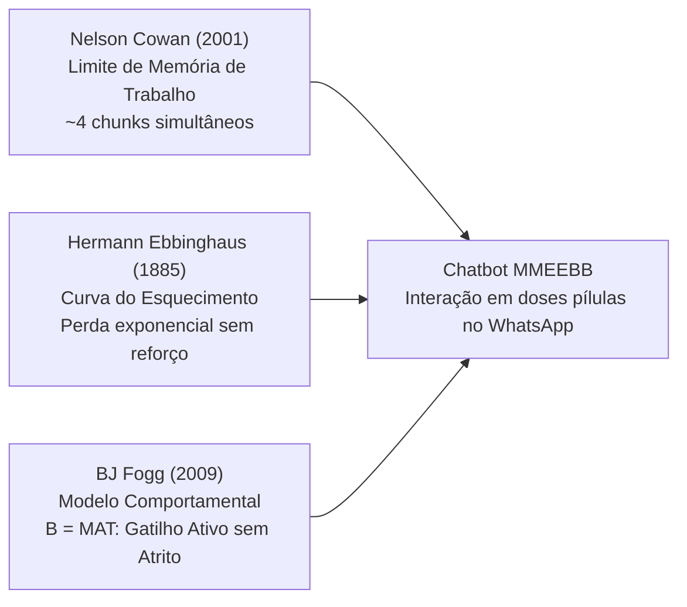
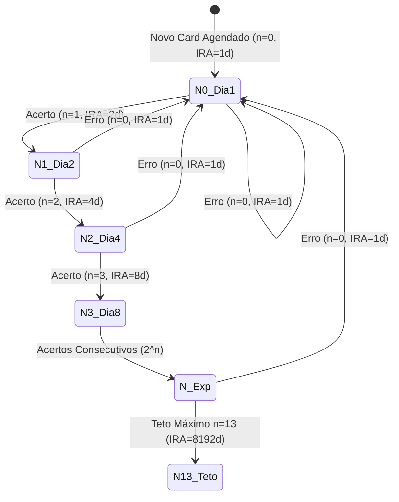
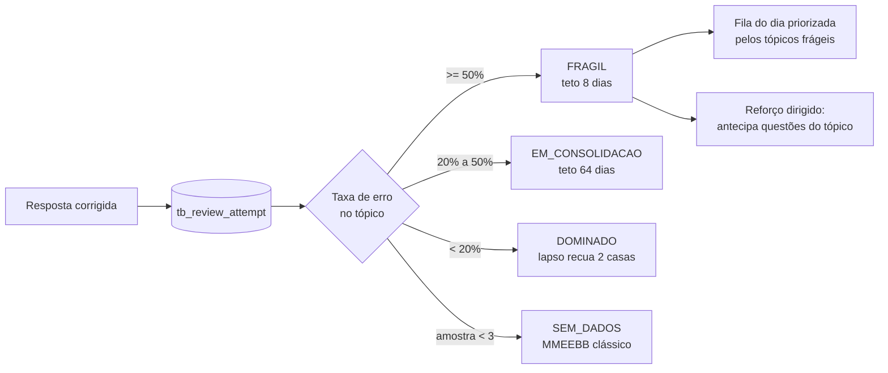
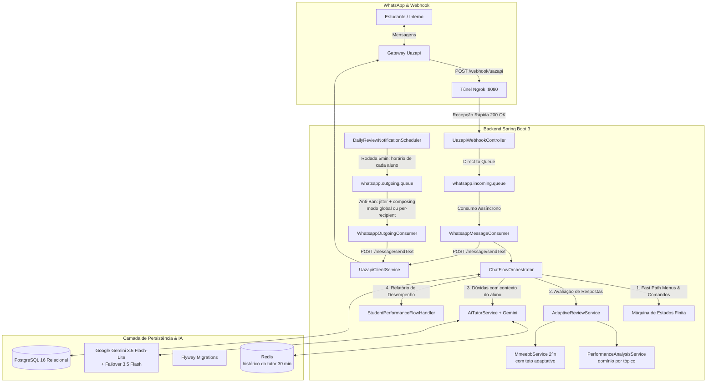
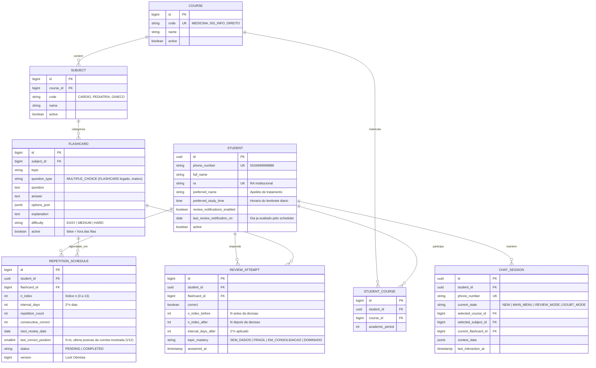

<div align="center">

# 🧠 Chatbot de Repetição Espaçada MMEEBB
### *Automação da Memorização Exponencial na Base Binária para Educação Médica e Superior*

[](https://openjdk.org/)
[](https://spring.io/projects/spring-boot)
[](https://www.postgresql.org/)
[](https://www.rabbitmq.com/)
[](https://ai.google.dev/)
[](https://github.com/langchain4j/langchain4j)
[](https://junit.org/junit5/)

---

**Trabalho de Conclusão de Curso (TCC)**  
**Instituição:** Centro Universitário de Patos de Minas ([UNIPAM](https://unipam.edu.br))  
**Curso:** Bacharelado em Sistemas de Informação  
**Autor:** Níckolas Tavares do Nascimento  
**Orientadora:** Profa. Dra. Mislene Dalila da Silva  

</div>

---

## 📌 Sumário
- [1. Visão Geral e Problema](#1-visão-geral-e-problema)
- [2. Fundamentação Teórica](#2-fundamentação-teórica)
- [3. O Algoritmo MMEEBB ($2^n$)](#3-o-algoritmo-mmeebb-2n)
- [3.1. Personalização Adaptativa por Desempenho](#31-personalização-adaptativa-por-desempenho-mmeebb-adaptativo)
- [4. Arquitetura da Solução](#4-arquitetura-da-solução)
- [5. Modelagem de Dados & DER](#5-modelagem-de-dados--der)
- [6. Stack Tecnológica](#6-stack-tecnológica)
- [7. Como Executar o Projeto](#7-como-executar-o-projeto)
- [8. Variáveis de Ambiente](#8-variáveis-de-ambiente)
- [9. Integração com WhatsApp (Uazapi & Ngrok)](#9-integração-com-whatsapp-uazapi--ngrok)
- [10. Suíte de Testes (TDD)](#10-suíte-de-testes-tdd)
- [11. Estrutura do Código](#11-estrutura-do-código)
- [12. Banco de Questões](#12-banco-de-questões)
- [13. QA, Carga e Anti-Banimento](#13-qa-carga-e-anti-banimento)
- [14. Decisões de Projeto](#14-decisões-de-projeto)
- [15. Governança Git & Commits Semânticos](#15-governança-git--commits-semânticos)

---

## 1. Visão Geral e Problema

Estudantes de graduações densas — em especial os cursos de **Medicina** durante as fases de **Internato e Residência Médica** — enfrentam jornadas exaustivas que ultrapassam 40 a 60 horas semanais. Essa rotina gera dois desafios críticos:
1. **Sobrecarga Cognitiva e Fadiga:** Dificuldade extrema em encontrar tempo dedicado para abrir aplicativos tradicionais de estudo (como Anki ou flashcards manuais).
2. **Declínio Rápido da Retenção:** Conhecimentos clínicos e diagnósticos complexos são rapidamente esquecidos se não forem reforçados ativamente em intervalos matematicamente dosados.

Este projeto propõe e implementa um **Chatbot Inteligente no WhatsApp** que automatiza o agendamento de revisões ativas com o método **MMEEBB**, atua como um **Preceptor/Tutor Médico Virtual via IA Generativa (Google Gemini, com o contexto acadêmico do aluno e memória curta da conversa)** e elimina toda a fricção de uso ao entregar os questionamentos diretamente no canal de comunicação mais acessado pelo estudante.

O sistema vai além do cálculo fixo de intervalo: ele **mede em quais conteúdos cada aluno erra mais e ajusta as revisões a isso**, encurtando o ciclo dos tópicos frágeis, priorizando-os na fila do dia e antecipando questões relacionadas após um erro — sem abandonar a base binária do método (ver [seção 3.1](#31-personalização-adaptativa-por-desempenho-mmeebb-adaptativo)).

---

## 2. Fundamentação Teórica

O projeto fundamenta-se na convergência de três pilares científicos e comportamentais:



1. **A Capacidade Mágica de Cowan (2001):** Demonstra que a atenção humana imediata comporta apenas $\approx 4$ blocos (*chunks*) de informação. O chatbot envia pílulas clínicas diárias que respeitam essa barreira cognitiva.
2. **A Curva do Esquecimento de Ebbinghaus (1885):** Mostra que a retenção cai drasticamente nas primeiras horas após o aprendizado. Revisões espaçadas ativas achatam a curva e consolidam as memórias de longo prazo.
3. **O Modelo Comportamental de BJ Fogg (2009) ($B = M \times A \times T$):** Um comportamento ($B$) só ocorre quando há Motivação ($M$), Habilidade/Facilidade ($A$) e Gatilho (*Trigger* - $T$). O chatbot atua como o **Gatilho Ativo (Push Notification)** dentro do WhatsApp, reduzindo o esforço do aluno a quase zero.

---

## 3. O Algoritmo MMEEBB ($2^n$)

O sistema utiliza o **Método de Memorização Exponencial Efetivo na Base Binária** (Ferreira et al., 2014):

### Fórmula do Intervalo de Reforço de Aprendizado (IRA):
$$\text{IRA} = 2^n \text{ dias}, \quad \text{onde } n \in [0, 13]$$



- **Início ($n = 0$):** O primeiro reforço ocorre $2^0 = 1$ dia após o contato com o conteúdo.
- **Acerto (Feedback Positivo):** O índice $n$ avança uma posição ($n \leftarrow \min(n+1, 13)$), dobrando o intervalo ($1 \to 2 \to 4 \to 8 \to 16 \dots$ dias).
- **Erro (Feedback Negativo):** O índice é resetado ($n \leftarrow 0$), retornando imediatamente para a fila de revisão do dia seguinte ($2^0 = 1$ dia).

---

## 3.1. Personalização Adaptativa por Desempenho (MMEEBB Adaptativo)

O MMEEBB clássico aplica exatamente a mesma progressão a todo aluno e a todo conteúdo. Na prática, um interno que erra sistematicamente *antibioticoterapia* e acerta sempre *semiologia cardíaca* recebia o mesmo tratamento nos dois assuntos. A camada adaptativa corrige isso **sem abandonar a base binária**: o intervalo continua sendo exatamente $2^n$ — o que muda é **até onde $n$ pode crescer** e **o tamanho do recuo no erro**.

### Como o sistema descobre onde o aluno erra

Cada resposta corrigida vira um evento em `tb_review_attempt` (com o $n$ antes, o $n$ depois e o domínio vigente). A partir desse histórico, o sistema calcula a **taxa de erro por tópico** dentro de uma janela móvel (padrão: 90 dias) e classifica o domínio:

| Taxa de erro no tópico | Domínio | $N_{max}$ | Intervalo máximo |
| :--- | :--- | :---: | :--- |
| amostra < 3 respostas | `SEM_DADOS` | 13 | 8192 dias *(MMEEBB clássico)* |
| $\ge 50\%$ | `FRAGIL` | 3 | **8 dias** |
| $20\%$ a $50\%$ | `EM_CONSOLIDACAO` | 6 | **64 dias** |
| $< 20\%$ | `DOMINADO` | 13 | 8192 dias *(MMEEBB clássico)* |

A unidade de análise é o **tópico**, não o cartão: "o conteúdo em que o aluno erra mais" é um assunto, e uma questão nova de um tópico frágil já nasce tratada como frágil. O desempenho de um cartão isolado já está representado pelo próprio $n$.

### A fórmula adaptativa

$$n' = \min\big(\max(\text{candidato},\ 0),\ \min(13,\ N_{max})\big), \qquad \text{IRA} = 2^{n'}$$

$$\text{candidato} = \begin{cases} n + 1 & \text{acerto} \\ n - 2 & \text{erro em tópico } \texttt{DOMINADO} \\ 0 & \text{erro nos demais casos} \end{cases}$$

> **Degradação graciosa:** com `SEM_DADOS` o teto é o próprio 13 e a fórmula colapsa em $n+1$ / $0$ — o MMEEBB original, bit a bit. Um teste percorre $n = 0 \dots 13$, em acerto e em erro, provando essa equivalência. Sem evidência de desempenho, **não há personalização alguma**.



### As quatro decisões adaptativas

1. **Teto por domínio** — enquanto o tópico for frágil, o cartão não escapa do ciclo curto, por mais que o aluno acerte. Ele volta a subir sozinho quando a taxa de erro do tópico cair.
2. **Lapso graduado** — errar um cartão de tópico dominado recua duas casas ($64 \to 16$ dias) em vez de zerar: um deslize isolado não apaga meses de consolidação. O reset total continua valendo em todos os outros casos.
3. **Fila priorizada** — entre as revisões vencidas do dia, os tópicos mais frágeis vêm primeiro. Importa porque o interno cansado costuma responder só as primeiras questões da sessão (limite de ~4 *chunks* de Cowan).
4. **Reforço dirigido** — ao errar em tópico frágil, o sistema antecipa até 2 questões **do mesmo tópico** para o dia. O limite se auto-regula contando quantas já estão vencidas, então errar várias vezes seguidas não gera uma fila infinita.

### Onde a IA entra (e onde não entra)

| Etapa | Responsável | Por quê |
| :--- | :--- | :--- |
| Corrigir a resposta dissertativa | 🤖 Gemini | É o sinal que alimenta todo o resto |
| Classificar o domínio do tópico | ⚙️ Determinístico | Precisa ser reprodutível e auditável diante da banca |
| Decidir o intervalo | ⚙️ Determinístico | É o algoritmo do TCC; precisa ser verificável |
| Explicar o desempenho ao aluno | 🤖 Gemini | Linguagem natural é onde o modelo agrega |
| Tirar dúvidas de conteúdo | 🤖 Gemini | Livre, orientado pelo perfil do aluno e pela conversa; na revisão, explica sem entregar o gabarito |

Toda decisão que diverge do MMEEBB clássico é **explicada na própria mensagem** do WhatsApp — um intervalo que encurta depois de um acerto, sem justificativa, seria lido pelo aluno como defeito do sistema.

> A camada inteira pode ser desligada com `MMEEBB_ADAPTIVE_ENABLED=false`, o que devolve o sistema ao MMEEBB clássico. Além de servir de contingência, isso habilita a comparação experimental *clássico × adaptativo* na monografia.

---

## 4. Arquitetura da Solução

O sistema foi concebido sob o padrão **Direct-to-Queue Messaging** e **Arquitetura em Camadas Enterprise**, garantindo isolamento assíncrono, proteção contra sobrecargas e tolerância a falhas.



### 4.1. Máquina de Estados Finita (FSM) & Comandos Conversacionais

O fluxo conversacional é gerenciado por uma **FSM determinística** (`ChatFlowOrchestrator`) cujo estado vive no **Redis**, chaveado pelo número de WhatsApp e com TTL de expiração automática. O PostgreSQL guarda apenas o que é durável (estudante, matrícula e agendamentos), eliminando a escrita relacional a cada troca de estado.

#### Primeiro contato: formulário de cadastro

O número de WhatsApp é a chave única do estudante. Quando um número desconhecido envia a primeira mensagem, o bot aplica um formulário de três etapas antes de liberar o menu:

| Etapa | Estado da FSM | Campo coletado |
| :--- | :--- | :--- |
| 1 de 3 | `AWAITING_FULL_NAME` | Nome completo (exige nome e sobrenome) |
| 2 de 3 | `AWAITING_RA` | RA — aceita `pular`, e recusa RA já vinculado a outro número |
| 3 de 3 | `AWAITING_COURSE` → `AWAITING_ACADEMIC_PERIOD` | Curso e período letivo |

Ao concluir, o sistema grava `tb_student` + `tb_student_course` e **inicializa os agendamentos MMEEBB** de todas as questões ativas do curso, deixando a primeira rodada disponível imediatamente (ver nas [decisões de projeto](#14-decisões-de-projeto) o efeito de "300+ revisões vencidas no 1º dia"). Números já cadastrados nunca repetem o formulário, mesmo após a sessão expirar no Redis.

#### Após o cadastro: menu fixo + texto livre

O estudante pode usar os números do menu ou **escrever livremente**. Texto livre passa por um classificador de intenção (Gemini) que também extrai a disciplina citada, usada como contexto da resposta do tutor:

| Intenção | Gatilhos | Comportamento |
| :--- | :--- | :--- |
| **📚 START_REVIEW** | `1`, ou texto livre como *"quero estudar um pouco"* | Inicia a revisão das questões pendentes do dia ($2^n$), com o contador "faltam N hoje". |
| **💡 ASK_DOUBT** | `2`, ou qualquer pergunta de conteúdo | Responde pelo tutor de IA com o perfil do aluno (curso, período, disciplina citada em *"dúvida de cardiologia"*) e as últimas 6 trocas da conversa (30 min). Não há base de conhecimento: a IA responde livremente, com diretrizes de segurança no prompt. |
| **⚙️ OPEN_SETTINGS** | `3`, `configurações`, `config`, `ajustes`, ou *"quero mudar meu horário"* | Abre o menu de Configurações (nome de tratamento, horário do lembrete, pausar lembretes, curso e período). |
| **📊 SHOW_PERFORMANCE** | `4`, `desempenho`, `progresso`, `estatísticas`, `como estou`, ou *"será que estou melhorando?"* | Envia o relatório de desempenho: taxa de acerto, tópicos em que mais erra (com o teto de intervalo ativo em cada um), conteúdos consolidados e a leitura do preceptor virtual. |
| **📋 SHOW_MENU** | `menu`, `oi`, `bom dia`, `ajuda` | Reexibe o menu principal. |
| **🚪 EXIT** | `sair`, `tchau`, `encerrar`, `flw`, `/sair` | Finaliza a sessão com despedida e limpa o card ativo. |

> Durante o formulário de cadastro os comandos globais ficam desativados: `menu` ali é uma resposta possível do estudante, não um comando de reset.

#### Apresentação da questão e correção das respostas

O banco é de **questões de múltipla escolha** (ver [seção 12](#12-banco-de-questões)). A cada apresentação as **alternativas são embaralhadas** e a **letra correta é sempre diferente da última vez que aquele aluno viu a questão** (a posição fica guardada no agendamento, `tb_repetition_schedule.last_correct_position`, migration V12). A ordem exibida vive na sessão (Redis) e vale para a correção, para o tutor e para o reenvio da questão depois de uma dúvida; o gabarito no banco não muda.

Formato da questão no WhatsApp (nunca JSON cru):

```text
📚 *Revisão MMEEBB* · faltam *12* hoje
🏷️ _Cardiologia - Insuficiência Cardíaca_

❓ <enunciado>

*A)* ...
*B)* ...

✍️ _Responda com a letra (ex.: *B*)._
_Dúvida? Pergunte — não conta como erro._
```

O retorno mostra `✅ *Correto!* Alternativa *B*` ou `❌ *Não foi dessa vez.* Você marcou *A*.` com `✔️ Correta: *B)* <texto>`, a linha do próximo reforço (`📅 Próximo reforço em *4 dias* (2^2)`), a nota adaptativa quando houver, `💡 *Por quê:* <explicação>` e a próxima questão.

Múltipla escolha é resolvida por comparação direta: a mensagem inteira precisa ser a letra (com ou sem "letra"/"alternativa" e parêntese) ou o texto de uma alternativa real colado por extenso (`"A) Inibidor de SGLT2..."`). Uma pergunta que apenas **começa** com uma palavra de uma letra ("é a C?", "o que é FEVE?") não é mais lida como resposta (correção do bug 2.7, PR #4); o que não é resposta clara segue para o Gemini, que distingue dúvida de resposta. Respostas abertas (questões antigas sem alternativas) passam por **correção semântica via Gemini**, que aceita o conceito correto com palavras próprias e devolve um comentário pedagógico curto.

O resultado dessa correção não é descartado: ele vira um evento em `tb_review_attempt` e alimenta a [personalização adaptativa](#31-personalização-adaptativa-por-desempenho-mmeebb-adaptativo). Pedidos de ajuda (*"não entendi, pode explicar?"*) são detectados como dúvida, respondidos pelo tutor de IA — que recebe a questão com as alternativas na ordem exibida e o gabarito, mas é proibido de revelá-lo — e **não contam como erro** — contabilizá-los puniria justamente quem pede explicação.

### 4.2. Resiliência do Gemini (Retry & Failover Automático)

O LangChain4j 0.35.0 usa por padrão um timeout rígido de 10s no `OkHttpClient` do cliente Gemini, insuficiente para respostas mais elaboradas do tutor. O `GeminiServiceCustomizer` (`dev.langchain4j.model.googleai`) substitui o `OkHttpClient` interno via reflection e adiciona:

- **Timeouts estendidos:** `connect`/`read`/`write`/`call` de 60s (`DEFAULT_TIMEOUT` em `LangChain4jConfig`), eliminando `SocketTimeoutException` em respostas mais longas do Tutor Clínico.
- **Interceptor de alta demanda (`HighDemandRetryInterceptor`):** intercepta HTTP `503` (High Demand) e `429` (Rate Limit) do Google, retentando até 3 vezes com backoff progressivo (800ms, 1600ms).
- **Failover dinâmico de modelo:** na penúltima tentativa, reescreve a URL da chamada Retrofit trocando `gemini-3.5-flash-lite` ↔ `gemini-3.5-flash` (clusters/pools separados no Google), aumentando a chance de sucesso sem intervenção manual.

---

## 5. Modelagem de Dados & DER

O banco de dados adota modelagem dinâmica multi-curso e multi-disciplina:



---

## 6. Stack Tecnológica

| Componente | Tecnologia | Finalidade |
| :--- | :--- | :--- |
| **Backend** | Java 17 + Spring Boot 3.3.x | Core da aplicação e regras de negócio |
| **Banco Relacional** | PostgreSQL 16 | Persistência transacional das entidades e agendamentos |
| **Migrations** | Flyway | Versionamento e automação do schema SQL |
| **Mensageria** | RabbitMQ 3 Management | Desacoplamento assíncrono, buffers e proteção anti-ban |
| **Estado Conversacional** | Redis 7 | FSM do chatbot e histórico curto do tutor, ambos com TTL, sem escrita relacional por mensagem |
| **IA / LLM** | Google Gemini 3.5 Flash-Lite (fallback 3.5 Flash) + LangChain4j 0.35.0 | Tutor acadêmico com contexto do aluno, roteamento de intenção, correção semântica e diagnóstico de desempenho, com retry/failover automático em 503/429 |
| **Gateway WhatsApp** | Uazapi / UazapiGO | Conexão com o WhatsApp, webhooks e envio de mensagens |
| **Túnel Local** | Ngrok | Exposição segura da porta `8080` para recepção de eventos |
| **Testes** | JUnit 5, Mockito, Spring Test, Testcontainers | Metodologia TDD; 561 testes na suíte |

---

## 7. Como Executar o Projeto

### Pré-requisitos
- [Docker e Docker Compose](https://www.docker.com/)
- [Java Development Kit (JDK 17+)](https://adoptium.net/)
- [Ngrok CLI](https://ngrok.com/download)

### Passo 1: Subir os Containers Docker
Na raiz do repositório, execute:
```powershell
docker compose up -d
```
> Isso iniciará o **PostgreSQL 16** (imagem `pgvector/pgvector:pg16`, exigida pela migration V1 histórica; a extensão não é mais usada) na porta `5432`, o **RabbitMQ** nas portas `5672` (AMQP) e `15672` (Painel Web: [http://localhost:15672](http://localhost:15672)) e o **Redis 7** na porta `6379`, usado para o estado conversacional do chatbot.
>
> Se a porta `5432` já estiver ocupada por outro Postgres na sua máquina, defina `POSTGRES_HOST_PORT=5433` (ou outra porta livre) no `.env` **antes** de subir os containers — o `docker-compose.yml` lê essa variável (`${POSTGRES_HOST_PORT:-5432}:5432`) e ajuste `SPRING_DATASOURCE_URL` de acordo.

### Passo 2: Configurar Variáveis de Ambiente (.env) e Rodar o Backend
Copie o modelo de ambiente ou edite o arquivo `.env` na raiz do projeto:
```powershell
Copy-Item .env.example .env
```
Preencha suas chaves no `.env`:
```properties
# Google Gemini (Chave gratuita em: https://aistudio.google.com/app/apikey)
GEMINI_API_KEY=sua_chave_gemini_aqui
GEMINI_MODEL_NAME=gemini-3.5-flash-lite
GEMINI_TEMPERATURE=0.2

# Chave de Administração REST
ADMIN_API_KEY=teste

# Gateway Uaizap
UAZAPI_BASE_URL=https://free.uazapi.com
UAZAPI_API_KEY=sua_chave_uazapi
UAZAPI_INSTANCE=sua_instancia
# Opcional: só se você quiser que o painel /setup provisione instâncias sozinho (ver seção 9)
UAZAPI_ADMIN_TOKEN=
```

Em seguida, inicialize a aplicação:
```powershell
.\mvnw.cmd spring-boot:run
```

> A lista completa de variáveis, com os padrões do código, está no [`.env.example`](.env.example) e na [seção 8](#8-variáveis-de-ambiente). **Atenção (achado A1):** a migration V6 grava `uazapi.base-url` em `system_configurations` e **o valor do banco vence o `.env`**; para trocar a URL da Uazapi num banco já migrado, use o painel `/setup` ou um `UPDATE` na tabela.

> **💡 Dica de Custo/Performance com Google Gemini:**  
> O modelo padrão configurado é o **`gemini-3.5-flash-lite`**, com failover automático para o `gemini-3.5-flash`, geração econômica e de altíssima velocidade do Google. O mesmo modelo atende o tutor de dúvidas, o roteamento de intenção e a correção de respostas — não há modelo de embeddings nem base vetorial para manter.

### Passo 3: Acompanhar o desempenho do grupo piloto

Os dois endpoints abaixo expõem os dados de retenção que embasam a seção de resultados da monografia — o mesmo diagnóstico que o aluno vê no WhatsApp, em formato consultável:

```powershell
# Perfil individual: taxa de acerto, tópicos frágeis e o teto de intervalo ativo em cada um
curl.exe -s "http://localhost:8080/api/admin/performance/students/<UUID>" -H "api_key: teste"

# Visão agregada de todos os estudantes, com desempenho por disciplina
curl.exe -s "http://localhost:8080/api/admin/performance/overview" -H "api_key: teste"
```

```json
{
  "windowDays": 90, "students": 7, "totalAttempts": 312, "overallAccuracy": 0.7115,
  "bySubject": [
    { "subjectId": 4, "subjectName": "Farmacologia Clínica", "attempts": 88, "accuracy": 0.5909 }
  ]
}
```

### Passo 4: Conectar o WhatsApp (túnel, QR Code e webhook)

Suba o túnel (o painel ainda não inicia o processo do Ngrok sozinho, só detecta um já rodando):
```powershell
ngrok http 8080
```

**Caminho recomendado a partir daqui — painel web automático:** acesse **`http://localhost:8080/setup`** com a aplicação rodando. Ele detecta o túnel Ngrok ativo automaticamente, provisiona uma instância na Uazapi se necessário (usando `UAZAPI_ADMIN_TOKEN`), gera e exibe o QR Code, faz o pareamento por polling e sincroniza o webhook sozinho assim que a instância conecta — zero passo manual além de rodar o `ngrok http 8080` e escanear o QR **ou** digitar o código de pareamento (campo "Número do bot", ver seção 9.1). Detalhes completos na seção 9.

**Caminho 100% manual (fallback, sem o painel):** copie a URL pública HTTPS gerada pelo Ngrok (ex: `https://xxxx.ngrok-free.app`) e, no painel da Uazapi, configure:
- **Webhook URL:** `https://xxxx.ngrok-free.app/webhook/uazapi`
- **Eventos:** `messages.upsert` (ou `messages`)

---

## 8. Variáveis de Ambiente

O modelo completo e comentado está em [`.env.example`](.env.example). Resumo:

| Variável | Valor Padrão | Descrição |
| :--- | :--- | :--- |
| `SPRING_DATASOURCE_URL` | `jdbc:postgresql://localhost:5432/mmeebb_db` | URL de conexão com o PostgreSQL |
| `SPRING_DATASOURCE_USERNAME` | `postgres` | Usuário do banco de dados |
| `SPRING_DATASOURCE_PASSWORD` | `postgres` | Senha do banco de dados |
| `POSTGRES_HOST_PORT` | `5432` | Porta do host mapeada pro Postgres no `docker-compose.yml` (mude se `5432` já estiver em uso) |
| `SPRING_RABBITMQ_HOST` | `localhost` | Host do RabbitMQ |
| `SPRING_RABBITMQ_PORT` | `5672` | Porta AMQP do RabbitMQ |
| `SPRING_RABBITMQ_USERNAME` | `guest` | Usuário do RabbitMQ |
| `SPRING_RABBITMQ_PASSWORD` | `guest` | Senha do RabbitMQ |
| `SPRING_REDIS_HOST` | `localhost` | Host do Redis (estado conversacional) |
| `SPRING_REDIS_PORT` | `6379` | Porta do Redis |
| `SPRING_REDIS_PASSWORD` | *(Vazio)* | Senha do Redis, se houver |
| `MMEEBB_SESSION_TTL_MINUTES` | `60` | Tempo de expiração da sessão conversacional no Redis |
| `MMEEBB_SCHEDULER_CRON` | `0 */5 * * * *` | Frequência das rodadas de lembrete; cada aluno recebe no horário definido em Configurações |
| `MMEEBB_ADAPTIVE_ENABLED` | `true` | Liga a [personalização adaptativa](#31-personalização-adaptativa-por-desempenho-mmeebb-adaptativo). `false` devolve o sistema ao MMEEBB clássico — útil para a comparação experimental na monografia |
| `MMEEBB_ADAPTIVE_WINDOW_DAYS` | `90` | Janela de análise do desempenho: um mês ruim não marca o tópico para sempre |
| `MMEEBB_ADAPTIVE_MIN_ATTEMPTS` | `3` | Respostas mínimas no tópico antes de personalizar qualquer coisa |
| `MMEEBB_ADAPTIVE_FRAGILE_ERROR_RATE` | `0.50` | Taxa de erro que classifica o tópico como frágil (teto de 8 dias) |
| `MMEEBB_ADAPTIVE_CONSOLIDATING_ERROR_RATE` | `0.20` | Taxa de erro que classifica o tópico como em consolidação (teto de 64 dias) |
| `MMEEBB_ADAPTIVE_REINFORCEMENT_MAX_CARDS` | `2` | Questões do mesmo tópico antecipadas como reforço após erro em tópico frágil |
| `MMEEBB_ADAPTIVE_REPORT_MIN_ATTEMPTS` | `5` | Respostas mínimas antes de exibir percentuais no relatório de desempenho |
| `MMEEBB_TUTOR_HISTORY_MAX_TURNS` | `6` | Trocas (pergunta + resposta) que o tutor de IA lembra por aluno |
| `MMEEBB_TUTOR_HISTORY_TTL_MINUTES` | `30` | Minutos sem conversa até o tutor esquecer o assunto |
| `UAZAPI_BASE_URL` | `https://free.uazapi.com` | URL base do gateway da Uazapi. **O valor salvo em `system_configurations` (semeado pela V6) vence esta variável** (achado A1) |
| `UAZAPI_API_KEY` | *(Vazio)* | Token/Chave de autenticação da Uazapi |
| `UAZAPI_INSTANCE` | *(Vazio)* | Nome da instância do WhatsApp conectada |
| `UAZAPI_ADMIN_TOKEN` | *(Vazio)* | Admintoken da sua conta Uazapi (dashboard, **não** é a mesma coisa que `UAZAPI_API_KEY`) — habilita o botão "Provisionar Nova Instância" no painel `/setup` |
| `UAZAPI_TYPING_DELAY_MS` | `2000` | Delay simulado de digitação (*composing*) |
| `UAZAPI_INBOUND_CONCURRENCY` | `3-6` | Consumidores simultâneos da fila de entrada (faixa mínimo-máximo) |
| `UAZAPI_ANTI_BAN_MODE` | `global` | Ritmo da fila de saída. `global` = estratégia original (um consumidor dorme jitter + composing de cada mensagem, alunos esperam uns pelos outros). `per-recipient` = cada aluno mantém o mesmo jitter + composing sem somar esperas entre alunos (ver [seção 13](#13-qa-carga-e-anti-banimento)). Valor desconhecido falha na subida |
| `UAZAPI_ANTI_BAN_GLOBAL_MIN_INTERVAL_MS` | `1000` | Intervalo mínimo entre dois textos quaisquer no modo `per-recipient` (1000 ms = até ~60/min). Ignorado no modo `global` |
| `GEMINI_API_KEY` | *(Vazio)* | Chave de API do Google AI Studio (Gemini) |
| `GEMINI_MODEL_NAME` | `gemini-3.5-flash-lite` | Modelo de chat principal (failover automático para `gemini-3.5-flash` em picos de demanda) |
| `GEMINI_TEMPERATURE` | `0.2` | Temperatura do modelo de chat (baixa, para respostas clínicas objetivas) |
| `PORT` | `8080` | Porta HTTP da aplicação |
| `GRAFANA_ADMIN_PASSWORD` | `admin` | Senha do Grafana no `docker-compose.yml` (opcional) |
| `ADMIN_API_KEY` | `teste` | Chave de segurança para endpoints `/api/admin/**` **e `/api/v1/setup/**`** (painel de conectividade) |
| `NGROK_CLIENT_API_URL` | `http://127.0.0.1:4040` | URL da API local de controle do Ngrok, usada pelo painel `/setup` para descobrir a URL pública do túnel |

---

## 9. Integração com WhatsApp (Uazapi & Ngrok)

### 9.1. Painel de Conectividade (`/setup`)

Conectar o bot ao WhatsApp manualmente (abrir o Ngrok, copiar a URL, colar no painel da Uazapi, gerar QR na mão) é um processo repetitivo e frágil para demonstrações — principalmente porque o **servidor demo gratuito da Uazapi (`free.uazapi.com`) expira instâncias automaticamente após 1 hora**. Para resolver isso, a aplicação expõe um painel web nativo em **`http://localhost:8080/setup`**, protegido pela mesma `ADMIN_API_KEY` dos endpoints `/api/admin/**`.

Fluxo do painel:
1. **Detecção do túnel**: consulta `GET http://127.0.0.1:4040/api/tunnels` (API local do Ngrok) para achar a URL pública ativa. Não inicia o processo do Ngrok sozinho — ele precisa estar rodando (`ngrok http 8080`).
2. **Provisionamento automático de instância** (`POST /api/v1/setup/instance/provision`): se não houver instância/token salvos (ou quando você clicar em "Provisionar Nova Instância"), a aplicação chama `POST /instance/init` na Uazapi com o **admintoken** da sua conta (`UAZAPI_ADMIN_TOKEN`, **diferente** do token de instância), recebe um token novo e salva **instância + token na tabela `system_configurations`** — não fica hardcoded em `.env`, então sobrevive a reinícios da aplicação mesmo trocando de instância a cada expiração de 1h.
3. **QR Code ou código de pareamento** (`POST /api/v1/setup/instance/connect`): chama `POST /instance/connect` com o token salvo. Sem número, extrai `instance.qrcode` (já em `data:image/png;base64,...`) e exibe o QR. **Com o número do bot** (campo "Número do bot" do painel, DDI + DDD, 10 a 15 dígitos; aceita `+`, espaços e hífens), envia `{"phone": "<dígitos>"}` e a Uazapi devolve um `paircode` de 8 caracteres (ex.: `ABCD-1234`), exibido em destaque; no celular do bot: *Aparelhos conectados → Conectar aparelho → Conectar com número de telefone*. Número inválido responde `ERROR` sem chamar a Uazapi, e o número não é salvo. O painel faz polling de status a cada 3s. Passo a passo do pareamento real em `docs/10-banco-questoes-qa-carga/PAREAMENTO_REAL.md` (local).
4. **Webhook automático**: assim que o polling detecta a instância `connected`, a aplicação configura o webhook sozinha (`POST /webhook` com a URL do Ngrok + eventos `messages.upsert`/`messages`) — idempotente, não reconfigura se já estiver apontando pra URL certa.
5. **Teste de fumaça**: botão dedicado dispara uma mensagem de teste real para o número informado.

### 9.2. Contrato real da API Uazapi

A documentação oficial (`docs.uazapi.com`) é uma SPA em JavaScript sem conteúdo acessível via scraping simples; o contrato abaixo foi confirmado testando diretamente contra `https://free.uazapi.com` (não por documentação lida):

| Ação | Rota | Header | Observação |
| :--- | :--- | :--- | :--- |
| Criar instância | `POST /instance/init` | `admintoken` | Body `{"name": "..."}`. Resposta traz `token` (novo) no root e em `instance.token`. |
| Conectar / obter QR ou código | `POST /instance/connect` | `token` | **Sem** nome de instância na URL — o token sozinho identifica a instância. Sem corpo: QR em `instance.qrcode`. Com `{"phone": "<número>"}`: código em `paircode` (ou `instance.paircode`). |
| Consultar status | `GET /instance/status` | `token` | Estado em `instance.status` (`connecting`/`connected`/`disconnected`). |
| Configurar webhook | `POST /webhook` | `token` | Body `{"url", "events", "enabled"}`. |
| Desconectar / apagar | `POST /instance/disconnect` / `DELETE /instance` | `token` | Disconnect mantém a instância; delete remove de vez. |

### 9.3. Referência adicional (arquivos locais, não versionados)

`docs/GUIA_NGROK_WEBHOOK.md` e `docs/uazapi/UAZAPI_API_REFERENCE.md` existem no repositório de trabalho local mas **não são versionados** (`docs/` está no `.gitignore` — são notas de planejamento, não documentação pública). Se você tem o repositório clonado localmente com esses arquivos, eles cobrem o fluxo 100% manual passo a passo.

---

## 10. Suíte de Testes (TDD)

O projeto adota rigorosamente a metodologia **TDD (Test-Driven Development)** e testes de fumaça (*smoke tests*) em todas as camadas de serviço, controllers, DTOs e entidades.

Para executar a suíte completa de testes:
```powershell
.\mvnw.cmd test
```

### Resultados Atuais:
- **Total de Testes:** 561 (branch `feat/pareamento-por-codigo`)
- **Taxa de Aprovação:** 100% (0 Falhas, 0 Erros, 1 Ignorado — `RedisChatSessionStoreTest`, que precisa de um Redis real)
- **Cobertura:** Cálculo matemático $2^n$, FSM de Sessões no Redis, formulário de cadastro, roteamento por intenção, correção de respostas (letra, alternativa colada, semântica), **embaralhamento das alternativas** (letra correta sempre diferente da última) e novo formato da questão, Tratamento de Intenção de Saída (*Exit Intent*), Tutor de IA com contexto e histórico (sem revelar gabarito em revisão), Consumidores RabbitMQ e **anti-banimento por destinatário**, Notificações Ativas Push, Controladores Administrativos, **Configurações do Estudante**, **Painel de Conectividade Uazapi/Ngrok** (túnel, provisionamento, QR Code, **pareamento por código**, webhook), **Personalização Adaptativa** e o **banco de questões** (contagens, gabarito e duplicatas validados contra o Postgres real via migration).

> A contagem de 561 vale para a linha `feat/pareamento-por-codigo` (PR #6). O PR #4 (`fix/achados-qa`) tem 545 testes porque parte de `feat/alternativas-embaralhadas` e não contém o anti-ban nem o pareamento.

> **Teste-chave do algoritmo:** `MmeebbServiceImplTest` percorre $n = 0 \dots 13$, em acerto e em erro, comparando a versão adaptativa sem histórico contra a clássica. É a prova executável de que a personalização **não descaracteriza o MMEEBB** — a contribuição central do trabalho permanece verificável.

> O teste `RedisChatSessionStoreTest` valida a ida e volta do estado por um Redis real e é **ignorado automaticamente** quando não há Redis acessível (porta `6399` por padrão, configurável via `REDIS_IT_PORT`), mantendo a suíte executável sem dependências externas.

> Os testes `RepetitionScheduleRepositoryTest`, `ReviewAttemptRepositoryTest`, `KnowledgeBaseRemovalMigrationTest`, `QuestionBankMigrationTest` e `SystemConfigurationRepositoryTest` sobem um **Postgres real (imagem `pgvector/pgvector:pg16`, exigida pela V1 histórica) via Testcontainers** e aplicam as migrations Flyway para validar o filtro de matrícula ativa, as consultas do reforço dirigido, as agregações de desempenho, a remoção da antiga base vetorial (V9) e o banco de questões (V10–V12) — o H2 não serve porque desconhece o tipo `jsonb` de `tb_flashcard`. Sem Docker disponível, eles são ignorados automaticamente; **confira `skipped=0` nos relatórios do surefire**, porque um "BUILD SUCCESS" não distingue teste executado de teste pulado.

---

## 11. Estrutura do Código

```text
c:\projeto-tcc
├── src/main/java/br/edu/unipam/tcc/
│   ├── config/          # Beans Spring (RabbitMQ, LangChain4j, Redis, etc.)
│   ├── consumer/        # Consumidores AMQP (@RabbitListener)
│   ├── controller/      # Endpoints REST e Webhooks (/webhook/uazapi)
│   ├── dto/             # DTOs de transporte de dados e mapeamento Uazapi
│   ├── entity/          # Entidades relacionais JPA (Course, Student, ReviewAttempt, etc.)
│   │   └── enums/       # ChatIntent, ChatState, TopicMastery
│   ├── exception/       # GlobalExceptionHandler e exceções de domínio
│   ├── flow/            # Handlers conversacionais (Configurações, Meu desempenho)
│   ├── observability/   # Métricas de domínio (Micrometer) e correlação de logs
│   ├── repository/      # Repositórios Spring Data JPA
│   ├── scheduler/       # Rotinas de disparo diário de revisões (@Scheduled)
│   ├── messaging/       # Anti-banimento da fila de saída (AntiBanMode, RecipientPacer, PerRecipientDispatcher)
│   ├── session/         # FSM conversacional e histórico do tutor no Redis (ChatSessionStore, ConversationHistoryStore)
│   ├── util/            # OptionShuffler (alternativas embaralhadas), ChatInputUtils
│   └── service/         # Interfaces e Implementações de regras de negócio
│       └── impl/        # ChatFlowOrchestrator, MmeebbService, AdaptiveReviewService,
│                        # PerformanceAnalysisService, AiTutorService, IntentRouterService...
├── src/main/java/dev/langchain4j/model/googleai/
│   └── GeminiServiceCustomizer.java  # Timeout estendido + retry/failover 503/429 no cliente Gemini
├── src/main/resources/
│   ├── db/migration/    # Scripts SQL Flyway (V1__init_schema.sql em diante)
│   ├── static/setup/    # Painel web de conectividade Uazapi/Ngrok (index.html + js/setup.js)
│   └── application.yml  # Configurações do Spring Boot
├── docs/                # Especificações técnicas e manuais operacionais (local, não versionado)
│   ├── uazapi/          # Referência completa da API Uazapi
│   └── GUIA_NGROK_WEBHOOK.md
├── docker-compose.yml   # PostgreSQL 16 (imagem pgvector, exigida pela V1) + RabbitMQ Management + Redis
└── pom.xml              # Dependências Maven do projeto
```

---

## 12. Banco de Questões

O banco tem **637 questões ativas, todas de múltipla escolha** (4 ou 5 alternativas, uma correta, explicação curta do porquê). Foram semeadas pelas migrations V2/V3 (55 questões) e V10 (582 questões novas, geradas e validadas mecanicamente por um script e revisadas uma a uma quanto a gabarito, ambiguidade e diretriz desatualizada).

| Curso | Ativas | Disciplinas (questões) |
| :--- | :-: | :--- |
| **Medicina** | 381 | Clínica Médica 107 · Cirurgia Geral 62 · Pediatria 60 · Ginecologia e Obstetrícia 60 · Medicina de Família e Comunidade 48 · Urgência e Emergência 22 · Saúde Mental 22 |
| **Sistemas de Informação** | 256 | Engenharia de Software 44 · Bancos de Dados e Persistência 43 · Estruturas de Dados e Algoritmos 41 · Segurança da Informação 36 · Redes e Distribuídos 36 · Programação Orientada a Objetos 28 · Gerência de Projetos de Software 28 |
| **Total** | **637** | Dificuldade — Medicina: 108 fáceis / 171 médias / 102 difíceis; SI: 77 / 117 / 62 |

- **Regras de conteúdo:** questões originais (nada copiado de banco protegido); Medicina segundo diretrizes brasileiras vigentes (MS, SBC, SBD, FEBRASGO, SBP/PNI, ATLS/ACLS), com a referência no campo `source`; enunciado legível no celular; nenhuma letra concentra mais de 40% dos gabaritos de um curso; nenhuma explicação cita a letra da alternativa (ela muda a cada apresentação).
- **Verificação executável:** `QuestionBankMigrationTest` (Testcontainers) sobe o Postgres, aplica V1..V12 do zero e confere contagens por curso e disciplina, gabarito presente nas alternativas, ausência de duplicatas, presença de fácil/média/difícil em cada disciplina e a distribuição das letras.
- **Questões antigas (`FLASHCARD`):** as 19 questões abertas das seeds V2/V3 foram **desativadas** na V10 (decisão com a orientadora: só questões fechadas). O histórico fica; as filas e as contagens só consideram `flashcard.active`. A V11 tirou "pgvector" da descrição da disciplina `BD_PERSIST`; a V12 criou `last_correct_position` e corrigiu uma explicação que citava letra.
- **Como cadastrar mais:** `POST /api/admin/flashcards` (com a `ADMIN_API_KEY`) ou uma nova migration Flyway (a próxima livre é a **V13**). Aluno **já cadastrado** só recebe questões novas pelo endpoint `POST /api/admin/students/by-phone/{tel}/seed-schedules` (ver decisões D10).

---

## 13. QA, Carga e Anti-Banimento

### 13.1. Matriz de QA

Uma matriz de **172 cenários em 17 áreas** (cadastro, menu, revisão, alternativas embaralhadas, adaptativo, tutor, configurações, relatório, lembrete, anti-banimento, mensagens duplicadas, sessão expirada, falhas do Gemini/Uazapi, concorrência, risco de 300+ revisões, questões novas para aluno antigo, banco) foi **executada de forma simulada**: a stack real (Postgres, RabbitMQ, Redis, a aplicação empacotada e o Gemini real) com um stub fazendo o papel da Uazapi/WhatsApp, em conversas completas de vários alunos, inclusive simultâneas.

| Resultado | Cenários |
| :--- | :-: |
| ok | 145 |
| achado (defeito ou limitação registrada) | 13 |
| observado (comportamento documentado, sem correção) | 13 |
| só no WhatsApp real (legibilidade, BAN-04) | 1 |
| falhou | 0 |

**Isto é validação simulada, não WhatsApp real:** o pareamento do número do bot ficou como pendência, com o passo a passo pronto. Itens a conferir no aparelho: renderização do negrito/itálico do novo formato, legibilidade de enunciados longos e das 15 questões com `*`, `_` ou `~` no texto.

Defeitos que contradiziam regra documentada foram corrigidos no PR #4 (`fix/achados-qa`): o bug 2.7 (pergunta que começa com palavra de uma letra, como "é a C?", era corrigida como resposta), a fila de revisão que ignorava `flashcard.active` e o reforço dirigido que antecipava a própria questão errada (A10). O restante está nas [pendências](#14-decisões-de-projeto) abaixo.

### 13.2. Teste de carga (latência com 1, 5 e 10 alunos simultâneos)

Medido com a stack isolada, anti-banimento de produção (entrada 3–6 s, digitando 2 s, jitter 3–6 s e *composing* 1,5 s na saída), Gemini real e 3 repetições por cenário (432 amostras por rodada, 0 anomalias). **Gargalo:** o consumidor de saída é único e serializa todos os alunos — o 10º aluno simultâneo recebia a resposta em ~62 s, e a saída respondia por 84% da latência.

**Anti-banimento por destinatário** (PR #5, rascunho, atrás de configuração): cada aluno mantém o mesmo jitter e *composing*, mas alunos diferentes deixam de somar esperas; um teto global (`UAZAPI_ANTI_BAN_GLOBAL_MIN_INTERVAL_MS`, padrão 1000 ms) impede rajadas. O padrão continua `UAZAPI_ANTI_BAN_MODE=global` (a estratégia original descrita no artigo); `per-recipient` é opt-in e **a decisão de ligá-lo em produção é do autor**.

| p95 com 10 alunos simultâneos (s) | Antes (`global`) | Depois (`per-recipient`) |
| :--- | :-: | :-: |
| Primeiro contato / cadastro / menu / 1ª questão / resposta | 59,5 – 62,5 | **16,4 – 18,2** |
| Dúvida ao tutor (Gemini ×2) | 65,4 | **36,1** (sobra é Gemini, não a fila) |
| Posição de entrega do 10º aluno | 62,4 | 19,2 |

Com 5 alunos o p95 passou de 31,8–37,3 s para 12,0–16,8 s; com 1 aluno nada muda. Com a saída destravada, o gargalo das dúvidas simultâneas passa a ser o Gemini (429/failover) e a fila de entrada. Relatório completo e roteiro de reprodução: `docs/10-banco-questoes-qa-carga/RELATORIO_CARGA.md` (local).

---

## 14. Decisões de Projeto

### 14.1. Remoção da base de conhecimento (RAG)

- **O que saiu:** pgvector, embeddings, ingestão de documentos (Tika), busca vetorial e a rota `/api/admin/rag/*`, que agora responde 404. Dúvidas vão direto ao Gemini com o perfil do aluno (curso, período, disciplina citada), a questão em revisão (com o gabarito confidencial) e as últimas trocas da conversa.
- **Motivo:** o acervo era pequeno e só continha o gabarito das próprias questões, o que gerava "não encontrei referências" para dúvidas legítimas — atrito num produto cujo princípio é eliminar a fricção (Fogg, 2009).
- **Troca consciente:** abre-se mão da **ancoragem em material oficial** (respostas rastreáveis a um documento) em favor da **cobertura** (o tutor responde a qualquer dúvida).
- **Mitigação do risco de alucinação:** o prompt manda admitir incerteza, não inventar doses nem referências e confirmar condutas com o preceptor; em revisão, o tutor recebe o gabarito mas é proibido de revelá-lo. Esse risco precisa constar na discussão da monografia.
- **Resíduo técnico:** a imagem do Postgres continua `pgvector/pgvector:pg16` porque a migration V1 (histórica, imutável) executa `CREATE EXTENSION vector`. A extensão não é usada.

### 14.2. Comportamentos conhecidos, documentados e não alterados

Mudanças aqui alterariam o MMEEBB descrito no artigo ou o ritmo de envio; ficam para decisão do autor com a orientadora.

| Item | Comportamento | Por que não foi mexido |
| :--- | :--- | :--- |
| **D7** — avalanche no 1º dia | Aluno novo recebe **300+ revisões vencidas no 1º dia**: a semeadura agenda todas as questões do curso para hoje e não há limite diário (Medicina 381, SI 256). Medido: cadastro concluído semeia 381 agendamentos | Escalonar ou limitar por sessão muda o método. Decidir com a orientadora |
| **D10** — questões novas só no cadastro | `ScheduleSeedingService` só roda no cadastro e na troca de curso; aluno antigo não recebe questões novas sozinho (usar `POST /api/admin/students/by-phone/{tel}/seed-schedules`, que é por disciplina e cria um "Estudante Teste" se o telefone não existir) | Semear no boot muda o comportamento nesta leva |
| **D8** — estratégia anti-ban | `per-recipient` existe mas vem desligado | Está descrita no artigo; a troca é decisão do autor |
| **A1** — URL da Uazapi no banco | A V6 semeia `uazapi.base-url` em `system_configurations` e **o banco vence o `.env`** | Era premissa errada do plano de testes. Bancos de QA/carga precisam esvaziar a chave antes do 1º webhook, senão a aplicação chama a Uazapi real |
| **FAL-03** — Gemini fora na correção | Falha do Gemini na correção semântica é tratada como resposta incorreta (reinicia o ciclo) | É o fallback **documentado** na spec-06 (l. 118); decisão de projeto |

### 14.3. Achados apenas documentados

Sem regra escrita que exija mudança, ou ficam para a decisão do autor (detalhes na matriz de QA, local):

- **DUP-06/07:** sem deduplicação por `messageId` — a mesma mensagem entregue duas vezes gera duas respostas; na revisão, a 2ª entrega corrige a *próxima* questão.
- **FAL-08:** com todas as rotas de envio da Uazapi falhando, a mensagem é perdida (sem retry nem fila de mensagens mortas) e a sessão já avançou.
- **FAL-11 / SES-06:** exceção no orquestrador (Postgres ou Redis fora) deixa o aluno sem resposta e sem nova tentativa.
- **A11:** o tutor responde com `**negrito**` de Markdown em ~46% das respostas (o WhatsApp usa `*negrito*`).
- **A12:** webhook com campo de tipo inesperado devolve 500 (a referência da Uazapi pede 200).
- **A13:** cadastro simultâneo de dois alunos com o mesmo RA deixa o 2º preso sem resposta até a sessão expirar.
- **A14:** palpite "é a X?" depois da correção do bug 2.7 fica a critério do Gemini (resposta ou dúvida).
- **A7/A8/A9** (carga): o teto global vale para o horário planejado (variação de ~3% no intervalo medido); sob dúvidas simultâneas o gargalo passa a ser o Gemini; falha do Gemini no tutor vira aviso sem nova tentativa.

---

## 15. Governança Git & Commits Semânticos

O repositório adota o padrão **Conventional Commits**:

- `feat(escopo): descrição da nova funcionalidade`
- `fix(escopo): correção de bug`
- `test(escopo): adição ou melhoria de testes unitários`
- `docs(escopo): atualização de documentação ou especificações`
- `refactor(escopo): refatoração de código sem alteração de comportamento`
- `chore(escopo): tarefas de build, dependências ou configurações`

---

<div align="center">
  <sub>Desenvolvido com ☕ e dedicação por <b>Níckolas Tavares do Nascimento</b> — TCC UNIPAM 2026</sub>
</div>
